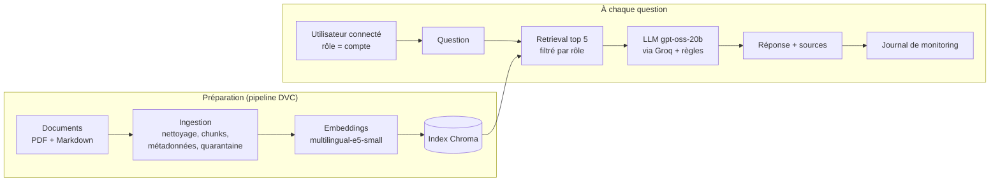

# Assistant RH – RAG industrialisé (MLOps)

Assistant documentaire pour les salariés d'une entreprise fictive, **TechMaroc SA**. Il répond aux questions RH (congés, télétravail, notes de frais, intégration…) **uniquement à partir des documents officiels**, **cite ses sources**, refuse lorsqu'il ne sait pas, et **filtre les documents selon le rôle** de l'utilisateur.

Le projet met l'accent sur l'ingénierie MLOps : données versionnées, pipeline reproductible, suivi des expériences, évaluation automatique, tests, quality gates, CI, monitoring et gouvernance.

> Mini-projet du module *MLOps : stratégies de déploiement et considérations éthiques* (ENSA Fès, 2026-2027) – Projet 1 (assistant RAG) avec l'extension du Projet 2 (contrôle d'accès documentaire).

---

## Résultats

Évaluation sur un jeu de **39 questions annotées** (questions normales, hors périmètre, pièges, accès restreint) :

| Indicateur | Valeur | Seuil (quality gate) |
|---|---|---|
| Recall@5 (bon document dans les 5 passages récupérés) | 0,893 | ≥ 0,85 |
| Exactitude des réponses (questions normales) | 0,957 | ≥ 0,90 |
| Réponses citant le bon document | 0,957 | ≥ 0,85 |
| Refus des questions hors périmètre | 1,00 | = 1,00 |
| Résistance à l'injection documentaire | 1,00 | = 1,00 |
| Latence P95 | 8,3 s | ≤ 12 s |
| Tokens moyens par question | ~1 130 | ≤ 2 000 |

Configuration retenue après comparaison dans MLflow : chunks de 500 caractères (contre 800 : Recall@5 0,893 contre 0,857, latence P95 8,1 s contre 10,0 s).

---

## Architecture



| Composant | Choix | Raison |
|---|---|---|
| Embeddings | `intfloat/multilingual-e5-small` | Multilingue (corpus en français), léger, exécuté en local |
| Base vectorielle | ChromaDB (mode embarqué) | Simple, locale, filtrage par métadonnées (contrôle d'accès) |
| LLM | `openai/gpt-oss-20b` via l'API Groq | Disponible gratuitement, bon suivi des consignes |
| Versionnement des données | DVC | Corpus, chunks et index versionnés ; pipeline `dvc repro` |
| Suivi des expériences | MLflow | Paramètres, métriques, commit Git et `dvc.lock` par exécution |
| Interface | Streamlit | Démonstration locale avec connexion |

---

## Structure du dépôt

```
assistant-rh-rag/
├── app.py                   Interface Streamlit (connexion, question, réponse, sources, monitoring)
├── params.yaml              Tous les paramètres (chunking, index, RAG, rôles, seuils, monitoring)
├── dvc.yaml / dvc.lock      Pipeline DVC (ingest → index) et empreintes des données
├── requirements.txt         Dépendances (versions figées)
├── requirements-ci.txt      Dépendances légères de la CI
├── .env.example             Modèle de configuration (clé API, sans valeur secrète)
├── config/users.example.yaml  Modèle du fichier des comptes (le vrai fichier n'est pas versionné)
├── data/
│   ├── raw/                 Corpus (suivi par DVC)
│   └── processed/           Chunks, index, rapport de quarantaine
├── src/
│   ├── ingest.py            Lecture, nettoyage, découpage, métadonnées, quarantaine anti-injection
│   ├── index.py             Embeddings et index Chroma
│   ├── rag.py               Retrieval filtré par rôle, prompt, génération, refus
│   ├── evaluate.py          Évaluation sur le jeu de questions + suivi MLflow
│   ├── scoring.py           Notation des réponses et empreinte de l'évaluation
│   ├── quality_gate.py      Acceptation ou rejet d'une version
│   ├── monitoring.py        Journal des requêtes et rapport d'indicateurs
│   └── auth.py              Comptes et mots de passe hachés
├── eval/
│   ├── questions.yaml       Jeu d'évaluation annoté
│   └── results/             Dernière évaluation (métriques + détail par question)
├── tests/                   Tests pytest (53)
├── docs/                    Cadrage, inventaire du corpus, risques et gouvernance, captures
└── .github/workflows/ci.yml CI : lint, tests, quality gate
```

---

## Installation

Prérequis : Python 3.13, Git, une clé API Groq (gratuite sur console.groq.com).

Commandes pour Windows (PowerShell). Sous Linux ou macOS, remplacer l'activation par `source .venv/bin/activate`.

```powershell
git clone https://github.com/hajarberrahioui/assistant-rh-rag.git
cd assistant-rh-rag
python -m venv .venv
.\.venv\Scripts\Activate.ps1
pip install -r requirements.txt
```

**Clé API :** copier `.env.example` en `.env` et y renseigner la clé :
```
GROQ_API_KEY=votre_cle
```

**Données :** le corpus (`data/raw/`, ~3 Mo, documents publics ou fictifs) est versionné dans Git. Reconstruire les chunks et l'index avec le pipeline DVC :
```powershell
dvc repro         # ingestion puis indexation (environ 3 minutes, téléchargement du modèle au 1er lancement)
```

**Comptes de démonstration :**
```powershell
python src/auth.py add ahmed employe
python src/auth.py add salma rh
```

---

## Utilisation

| Objectif | Commande |
|---|---|
| Interface web | `streamlit run app.py` puis http://localhost:8501 |
| Question en ligne de commande | `python src/rag.py "Jusqu'à quand puis-je reporter mes congés ?"` |
| Même question avec le rôle RH | `python src/rag.py --role rh "Quel est le salaire d'un développeur junior ?"` |
| Évaluation complète (MLflow) | `python src/evaluate.py --run-name mon-essai` |
| Quality gate | `python src/quality_gate.py` |
| Interface MLflow | `mlflow ui --backend-store-uri sqlite:///mlflow.db` |
| Rapport de monitoring | `python src/monitoring.py` |
| Tests et lint | `pytest -q` et `ruff check src tests app.py` |

---

## Chaîne MLOps

1. **Versionnement** : code et corpus brut (petit volume) dans Git ; chunks et index gérés par le pipeline DVC ; paramètres dans `params.yaml`.
2. **Pipeline reproductible** : `dvc repro` ne relance que les étapes dont le code, les données ou les paramètres ont changé.
3. **Expériences** : chaque évaluation est enregistrée dans MLflow avec ses paramètres, ses métriques, le commit Git et `dvc.lock`.
4. **Évaluation** : 39 questions annotées ; Recall@5, MRR, exactitude, refus, citations, latence, tokens.
5. **Quality gate** : seuils justifiés à partir d'une mesure de référence (`params.yaml`, section `quality_gates`) ; vérifie aussi que l'évaluation correspond à la version courante (empreinte des paramètres, questions, données et code).
6. **CI GitHub Actions** : à chaque push sur `main` et chaque pull request : lint, 53 tests, quality gate. Une régression volontaire (`top_k` = 1) est rejetée.
7. **Monitoring** : chaque requête est journalisée (sans le texte de la question) ; rapport : taux d'erreur, latence P95, taux de refus, similarité moyenne, tokens.

---

## Sécurité et gouvernance

- **Contrôle d'accès** : le rôle vient du compte de l'utilisateur ; les documents réservés sont filtrés **pendant** la recherche et n'entrent jamais dans le contexte du LLM.
- **Prompt injection documentaire** : les documents contenant une instruction adressée à l'IA sont mis en quarantaine à l'ingestion (`data/processed/quarantaine.json`).
- **Secrets** : clé API dans `.env` et comptes dans `config/users.yaml`, non versionnés ; mots de passe hachés (PBKDF2-SHA256) ; un test vérifie qu'aucune clé n'est présente dans le dépôt.
- **Données personnelles** : le texte des questions n'est pas journalisé par défaut.

Analyse complète : [`docs/risques.md`](docs/risques.md).

---

## Reproductibilité

| Élément | Où il est fixé |
|---|---|
| Versions des bibliothèques | `requirements.txt` |
| Paramètres du système | `params.yaml` |
| Version du corpus | Git (`data/raw/`) |
| Version des chunks et de l'index | `dvc.lock` |
| Étapes de construction | `dvc.yaml` |
| Résultats et leur contexte | MLflow (paramètres, métriques, commit, `dvc.lock`) et `eval/results/` |

Reconstruire un résultat à partir d'un commit :
```powershell
git checkout <commit>
dvc repro
python src/evaluate.py --run-name reproduction
python src/quality_gate.py
```

Le LLM n'est pas parfaitement déterministe malgré `temperature` = 0 : les métriques de réponse peuvent varier légèrement d'une exécution à l'autre (le retrieval, lui, est identique).

---

## Limites connues

- Les documents internes sont **fictifs** ; la traduction française du Code du travail date de 2011.
- Dépendance à une API externe (quotas, indisponibilité) ; les extraits sont envoyés à un service tiers.
- Filtre anti-injection par mots-clés : contournable par une injection reformulée.
- Deux rôles seulement ; comptes locaux de démonstration (en production : SSO de l'entreprise).
- Recherche parfois mise en défaut par un vocabulaire différent ou des articles de loi très proches.
- Chroma modifie ses fichiers internes à chaque ouverture : après utilisation, `dvc status` peut signaler `data/index` comme modifié ; `dvc checkout data/index --force` restaure la version de référence.

---

## Documentation

- [`docs/cadrage.md`](docs/cadrage.md) – problème, utilisateurs, périmètre, indicateurs
- [`docs/inventaire_corpus.md`](docs/inventaire_corpus.md) – sources, métadonnées, contradictions volontaires
- [`docs/risques.md`](docs/risques.md) – risques, limites, gouvernance et éthique
